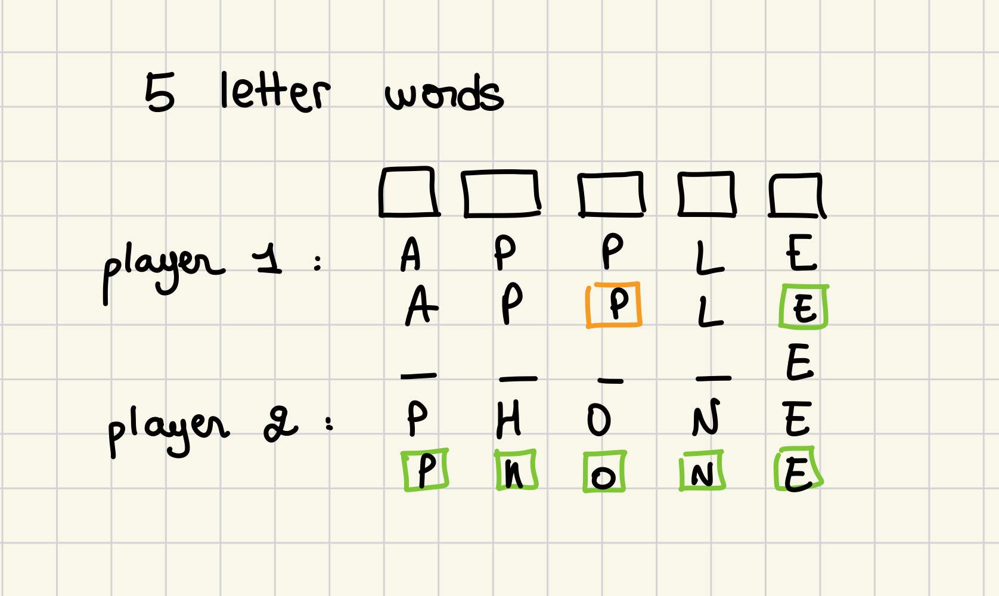

# Team 212

## Team members

```
 - Abouda Aicha - 361079, aicha.abouda@epfl.ch
 - Farhat Haythem - 372475, haythem.farhat@epfl.ch
 - Jribi Mohamed Aziz - 381749, mohamed.jribi@epfl.ch
 - Masmoudi Youssef - 375024, youssef.masmoudi@epfl.ch
```
## Proposal
Inspired by the game Wordle, GuessWord is a multiplayer word-guessing game where two players compete against each other to guess a five-letter word in six attempts. Each round, both players try to guess the same word, and their guesses are evaluated with feedback. The feedback indicates whether the guessed letter is in the correct position (green), in the wrong position (yellow), or not in the word at all (gray). If the word does not exist in our dictionary, it appears all in gray even thought some of its letters are correct. 
The game will alternate between the players, and whoever guesses the word first wins the round. 

- [+1] For a yellow letter 
- [+2] For a green letter 
- [+12] If guessed from the first try 
- If a letter is already placed or guessed (already green or yellow) you don't get more points for it.


### User stories
As a player, I want to guess a five-letter word before my opponent does, so that I can win the round and compete against my friend. 


### Requirements
The Wodle game will be a web-based word-guessing game where players try to guess a secret five-letter word within six attempts. Each day, a new word is chosen randomly from a predefined list. After each guess, players will receive color-coded feedback based on their input:
- Green: The letter is correct and in the correct position.
- Yellow: The letter is correct but in the wrong position.
- Gray: The letter is not in the word at all.
The game will track the number of guesses made by the player and limit the attempts to six. After completing the game, players can see how many tries it took them to guess the word. 

### Roles
- Aicha : Implementation of the back-end logic, including word processing, evaluating players' responses, and managing the scoring system.
- Youssef : In charge of setting up and managing the database, including storing words, player scores, and game scores.
- Haythem : Implementation of the front-end logic, including user interface design and style integration to ensure a smooth and engaging user experience.
- Aziz : Testing and quality assurance, ensuring each component works as expected and conducting performance tests to guarantee an optimal user experience.

### Mock-ups

